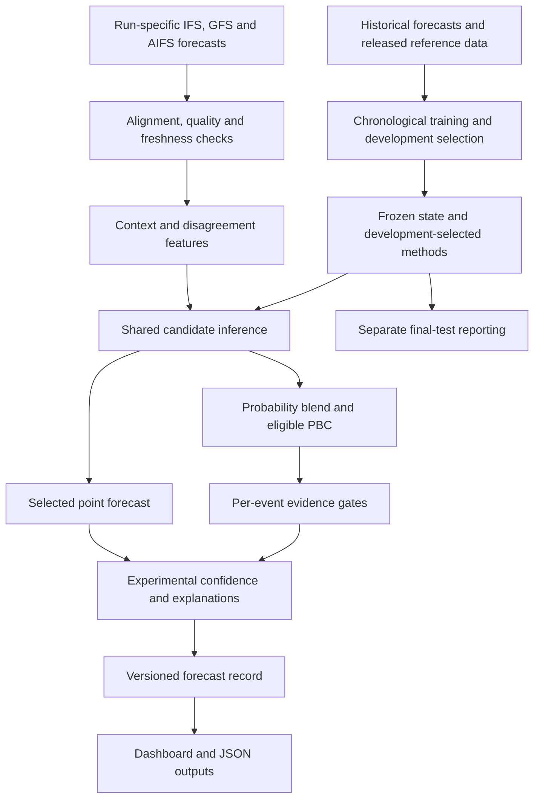

# Forecastdesk

### Three weather models. One explainable forecast.

Forecastdesk combines **IFS and GFS physics-based forecasts with AIFS AI forecasts**, learns how much each source should contribute, and shows the evidence behind the selected result. It helps a forecast reviewer answer three practical questions: **What is expected? Which sources contributed? How strong is the supporting evidence?**

The platform connects contextual weighting, probability blending, probabilistic bias correction, verification and traceable issuance in one inspectable workflow. Every product competes against strong simple alternatives before a method is selected.

**Python 3.12 + NumPy · Plain HTML, CSS and JavaScript · Real forecast inputs · IST display**

[Quick start](#quick-start) · [Capabilities](#what-we-have-built) · [Architecture](#how-the-system-works) · [Results](#measured-results) · [Demo](#demonstrating-the-platform) · [Roadmap](#next-stage)

## Why this project exists

Weather models can disagree sharply about the same place and time. One may capture a large weather system well while another performs better for a particular lead, season or local condition. Choosing one model everywhere ignores those differences; averaging everything hides the reasons behind the result.

Forecastdesk treats source trust as a decision that should be learned, tested and explained. Its contribution is the complete process connecting actual forecasts, contextual contributions, calibrated distribution candidates and a forecast record that reviewers can inspect.

| A forecast reviewer needs to know | Forecastdesk provides |
| --- | --- |
| What weather is expected? | A selected point forecast with units, location, horizon and valid time |
| Why was that forecast selected? | Source values, actual contributions, selected method and router explanations |
| How much do the models disagree? | Spread, range and pairwise disagreement measures |
| How strong is the evidence? | An experimental confidence index with visible contributing factors |
| Does a more complex method help? | Comparisons with individual models, corrected models, equal and fixed blends |
| What happens when a source fails? | Tested source-subset handling, fallback decisions and clear withholding reasons |
| Can a displayed result be traced? | Retained payloads, hashes, frozen model state and immutable issued records |

The system can retain a simple blend or corrected individual source when development evidence supports it. The router and PBC earn their place separately for each product.

## What we have built

| Capability | Implemented behaviour |
| --- | --- |
| **Hybrid AI and NWP inputs** | Run-specific IFS, GFS and AIFS forecasts, with source identities and raw responses retained |
| **Forecast Router** | Pooled ridge regression estimates each source's expected error and produces normalized, restrained candidate weights |
| **Contextual features** | Region, lead, month/season, forecast-derived regime, rolling released error, disagreement, climatology deviation and input availability/age |
| **Probability blending** | Valid source distributions derived from historical errors, with consistent weights across thresholds |
| **Probabilistic bias correction** | Bias and persistence corrections, including router + PBC candidates, evaluated separately from point forecasts |
| **Rainfall modelling** | Exact 24-hour matching and an experimental rain-occurrence plus conditional-amount distribution |
| **Confidence explanation** | A 0–100 evidence index, factor contributions and a held-out comparison of confidence with forecast error |
| **Missing-source handling** | Development-tested point fallbacks and separate probability calibration/event gates for supported source subsets |
| **Input freshness** | Run-age checks that distinguish fresh, slightly stale, excluded and invalid inputs |
| **Observation import** | CSV ingestion with quality, unit, release-time, location, accumulation-window and supplied spatial-support checks |
| **Verification** | Common-case comparisons, event scores, calibration checks and paired uncertainty intervals |
| **Automated workflow** | Fetch, evaluate, issue and refresh commands, plus a Windows daily scheduling script |
| **Traceable publication** | Versioned JSON/CSV issuance, retained payloads, frozen state checks and atomic latest snapshots |
| **Interactive dashboard** | Historical replay, contributions, location map, verification, provenance, outage simulation and Focus view |

### A deliberate pilot scope

The first implementation covers **Mumbai, Pune, Chennai, Bengaluru and Delhi**, with **24 and 72-hour forecast targets**. This keeps the complete workflow inspectable while exercising coastal and inland locations. Expansion will reuse the same data contracts and verification process as compatible regional histories become available.

The map shows contributions at the pilot's actual locations. It does not imply that five points establish a nationwide forecast surface.

## How the system works



### Align the inputs

Each case identifies initialization, valid time, lead, variable, units and target location. Rainfall carries explicit accumulation bounds. Storage and calculations use UTC; the dashboard displays IST. Missing values remain missing. Provider grid coordinates are retained separately from requested city coordinates.

### Learn source trust

The Forecast Router predicts each source's expected absolute error using information available before issuance. Smaller predicted errors receive larger candidate contributions. Weights are nonnegative, sum to one and shrink toward a fixed baseline when contextual evidence is limited.

Equal, fixed, historical contextual and corrected-source methods remain competing candidates. The dashboard distinguishes **the contributions actually used** from the router candidate's explanation.

### Produce point and probability forecasts

A point forecast supplies a familiar value in °C, m/s or mm/24h. A distribution describes possible outcomes and supports defined threshold events. Historical errors provide empirical distributions for deterministic sources; rainfall also has a two-part candidate representing dry/wet occurrence and the amount conditional on rain.

PBC tests whether bias correction and available lagged reference information improve those distributions. It does not alter the selected point forecast. Point and probability methods are selected independently on development data, then frozen for final testing and issuance.

### Explain the supporting evidence

The confidence index combines six fixed factors:

| Factor | Weight | What it describes |
| --- | ---: | --- |
| Model agreement | 20% | Agreement between available source forecasts |
| Historical skill | 20% | A historical error proxy using current contributions |
| Relevant evidence | 20% | Support from compatible historical cases |
| Freshness and availability | 15% | Input age and source availability |
| Similarity | 15% | How familiar the current case is relative to earlier cases |
| Probability reliability | 10% | Eligible development-period calibration evidence |

Unknown factors contribute zero; their weights are not redistributed. **This is an experimental evidence index, not a percentage chance of weather or a guarantee of accuracy.**

### Issue a reproducible record

Issuance shares candidate inference with evaluation and uses frozen selections. It checks history/state linkage, source timestamps, units and payloads before writing records. Supported outages use their own calibration and fallback decisions.

Versioned records cannot be silently overwritten. Refresh prepares new data, evaluation and issuance before promoting snapshots; an unsuccessful refresh preserves the existing dashboard data.

## Real data and provenance

**The active dashboard uses downloaded forecasts, not generated weather values.** Run-specific IFS, GFS and AIFS forecasts are acquired through Open-Meteo. ERA5 reanalysis supplies the current historical comparison reference.

Snapshot recorded **30 September 2026**:

| Evidence | Current snapshot |
| --- | --- |
| Pilot locations | 5 |
| Requested archive dates | 10 April to 21 September 2026, 165 dates |
| Matched case rows | 4,930 |
| Eligible evaluation issue dates | 164 |
| Final-test cases | 990 across 6 products, 165 per product |
| Numeric archive values matched to retained responses | 19,700 |
| Raw response hashes checked | 2,472 |
| Genuine missing source values retained | 20 |
| Saved 30 September 00 UTC issuance | 30 point-only records |
| Issued source values checked against retained payloads | 90 from 15 responses |

Rainfall is accumulated over exactly **08:30 to 08:30 IST**. From a 00 UTC initialization, the 24 and 72-hour target labels correspond to accumulation endpoints at **27 and 75 hours**. Temperature and 10 m wind use 24 and 72-hour valid-time offsets.

ERA5 is a model-based reanalysis reference, **not a station or rain-gauge observation**. Historical publication times are unverified; the experiment documents assumed six-hour model arrival and seven-day reference release delays. Spatial representativeness between provider grid cells and requested points remains unverified. These qualifications define the current results' scope.

The separate `demo` command produces explicitly labelled synthetic samples in `data/demo` and `output/demo`; it cannot overwrite the real dashboard state.

See the [data quality report](docs/data-quality-report.md), [evaluation state](output/state.json), [data audit](output/data-audit.json) and [saved issuance](output/issued/latest.json).

## Measured results

Methods are selected on chronological development data. The final test begins **20 August 2026**, after training and development, and reports frozen choices on common complete-input cases. Only reference values released before the relevant cutoff enter fitting or selection.

These values come directly from the saved evaluation state. Each row has **165 final-test cases**. MAE means average absolute error; RPS measures ordered probability-distribution error. Lower values are better.

| Product | Selected point method | Selected MAE | Equal-blend MAE | Selected probability method | RPS |
| --- | --- | ---: | ---: | --- | ---: |
| Rainfall, 24 h target | Fixed learned blend | 2.0370 mm/24h | 2.0701 mm/24h | Contextual empirical | 0.13854 |
| Rainfall, 72 h target | Fixed learned blend | 2.3866 mm/24h | 2.3632 mm/24h | Contextual empirical | 0.13845 |
| Temperature, 24 h | Bias-corrected AIFS | 0.4449 °C | 0.8129 °C | Router + PBC | 0.04881 |
| Temperature, 72 h | Bias-corrected AIFS | 0.4744 °C | 0.8933 °C | Router + PBC | 0.04749 |
| Wind, 24 h | Fixed learned blend | 0.3767 m/s | 0.3923 m/s | Contextual empirical | 0.08137 |
| Wind, 72 h | Bias-corrected AIFS | 0.4716 m/s | 0.5163 m/s | Contextual empirical | 0.08873 |

The results support product-specific choices. Temperature selects router + PBC for probabilities and corrected AIFS for point values. Rainfall retains a fixed point blend. Its 72-hour test MAE is slightly worse than equal averaging; the system reports that outcome and preserves the development-frozen choice instead of selecting again on the test.

The dashboard also exposes RMSE, bias, ablation comparisons, paired seven-day block bootstrap intervals, Brier scores, event counts, reliability, detection and false alarms. These are retrospective ERA5 comparisons within the pilot period, not station-based accuracy or nationwide skill claims.

### Extreme-weather guidance

The rainfall registry distinguishes **heavy rain ≥64.5 mm**, **very heavy rain ≥115.6 mm** and **extremely heavy rain ≥204.5 mm** per matched 24-hour period. Each event and source subset has its own evidence gate.

The current final test has no events at the defined hazard thresholds, and no authorized station series has been imported. Issued hazard probabilities are withheld with explicit reasons while eligible point forecasts remain available.

The research gate requires verified observation/support metadata, a fresh test calendar, sufficient cases/events, positive climatology-relative Brier skill, acceptable calibration and bounded uncertainty. It is not operational certification. A temperature threshold alone is not a heat-wave declaration, and mean wind is not a gust warning.

## The dashboard experience

The overview brings the three inputs, selected forecast, confidence evidence and typical test error together. Reviewers can change variable, location, horizon and historical issue while keeping the result connected to its source contributions.

| View or control | What the reviewer can do |
| --- | --- |
| **Overview** | Review the selected forecast, evidence index and average test error |
| **Model contributions** | Inspect source values, percentages and the actual method choice |
| **Why these weights?** | Examine router expected errors, factors and disagreement |
| **Location map** | Compare pilot locations and contribution views |
| **Historical replay** | Inspect an ordinary day or the highest observed event in the sample |
| **Reveal observation** | Show the ERA5 reference after reviewing the forecast |
| **Input scenario** | Remove a source and inspect fallback, confidence and withholding reasons |
| **Verification** | Compare methods on the same test cases and inspect event evidence |
| **Data provenance** | Review source identity, timing, reference and coverage |
| **Latest issued guidance** | Inspect saved outputs, source ages and status explanations |
| **Focus view** | Expand the workspace for screenshots and recorded demonstrations |

Navigation highlights follow the selected section, and visible timestamps use IST. Opening the page reads saved records; it does not fetch a new weather cycle.

## Quick start

Requirements: **Python 3.12** and **NumPy**. Node.js is needed only for dashboard checks. The application requires no frontend build step or external database.

From the project directory on Windows:

```powershell
py -3.12 -m pip install -r requirements.txt
py -3.12 -m sih081 serve
```

Open [Forecastdesk locally](http://127.0.0.1:8765/). On systems with Python 3.12 available as `python`, replace `py -3.12` with `python`.

The saved archive, evaluation, issued snapshot and source responses are included for a repeatable demonstration. Downloading a new archive is optional.

The server listens on `0.0.0.0:8765`. Other devices on the same network use this computer's actual LAN IP with port 8765. `0.0.0.0` is the listening address, not the address to enter on another device.

## Data and forecast workflow

### Refresh the current run

```powershell
py -3.12 -m sih081 refresh
```

Refresh uses all five locations, prepares a rolling archive, evaluates it and issues the current 00 UTC run after the assumed arrival delay. A matching already-issued run is skipped; unsuccessful preparation leaves the active snapshots intact.

For daily refresh on Windows:

```powershell
powershell -ExecutionPolicy Bypass -File scripts/register-refresh.ps1 -At 13:00
```

The task runs for the signed-in user. The example schedules 13:00 IST on a computer configured for IST; elsewhere `-At` follows the computer's local time. Registration alone does not establish that a scheduled acquisition succeeded.

### Fetch and evaluate an archive

```powershell
py -3.12 -m sih081 fetch --start 2026-04-10 --days 165 --rain-window imd
py -3.12 -m sih081 evaluate data/archive/cases.csv --manifest data/archive/manifest.json
py -3.12 scripts/check-real-data.py
```

These commands rebuild the active archive/evaluation. Use the included snapshots directly when reproducing the saved demonstration.

### Issue a run or replay history

```powershell
py -3.12 -m sih081 issue --run YYYY-MM-DDT00:00
```

Replace the placeholder with the intended 00 UTC run. Current issuance uses actual generation time, frozen selections and the evaluated history hash. Repeating a run/state cannot overwrite its versioned record.

For history, add `--replay` and keep outputs separate:

```powershell
py -3.12 -m sih081 issue --run 2026-09-21T00:00 --replay --output output/replay
```

Replay is explicitly retrospective, with age assessed at the assumed run +6-hour issuance time. Freshness uses initialization age: ≤12 hours fresh, >12–24 slightly stale, and >24 excluded. Future, unknown or timezone-less source timestamps are invalid.

### Import station or gauge observations

The importer accepts authorized historical CSV data. Required columns:

```text
region,latitude,longitude,variable,valid_time,observation,observed_at,source,quality,window_start,window_end,unit
```

Use timezone-aware timestamps, `quality=pass`, and units `°C`, `m/s` or `mm/24h`. Rain requires exact accumulation bounds; instantaneous targets require empty bounds. Coordinates must match within 0.01°.

Supply `observation_support`, `representativeness_status`, `representativeness_evidence`, `release_time_basis` and `source_url` where available. `observed_at` records when the reference became available. Matching coordinates alone does not establish grid-versus-station representativeness.

```powershell
py -3.12 -m sih081 merge-observations observations.csv --strict
py -3.12 -m sih081 evaluate data/observed/cases.csv --manifest data/observed/manifest.json --output output/observed
```

Imported observations are evaluated separately before changing the default dashboard. This pathway rejects reanalysis and synthetic source labels; legacy imports without units remain explicitly unverified.

### Read-only outputs

| Endpoint | Content |
| --- | --- |
| `/` | Dashboard |
| `/api/state` | Evaluation, selected methods, replay cases and verification |
| `/api/issued` | Latest issued snapshot linked to its evaluation state |

The JSON outputs support inspection and reuse. The server sends no-cache headers and returns an unavailable response for an issuance/evaluation mismatch.

## Demonstrating the platform

For a two-minute recording, use a desktop window and enable **Focus view**.

1. **Show the decision.** Start with rainfall, Mumbai and the 24-hour target. Point to the inputs, selected forecast, evidence index and typical error.
2. **Explain the contributions.** Show source amounts and percentages, then the router explanation and confidence factors.
3. **Show adaptation.** Change location or horizon and compare the result and evidence.
4. **Show failure handling.** Remove AIFS, inspect fallback/status reasons, then restore all sources.
5. **Reveal the reference.** Compare the replayed prediction with ERA5 after examining the inputs.
6. **Show verification.** Open the method comparison and explain development selection versus final-test reporting.

The highest observed event is the largest in this archive, not necessarily a severe-weather threshold exceedance. Identify recorded dates clearly during the presentation.

## Verification and project structure

Verification recorded on **30 September 2026**: **32 Python tests** and **four Node dashboard checks** passed. The data audit matched archive and saved issued values to retained responses. Frontend checks use a mocked DOM; this is not browser-based visual-layout certification.

```powershell
py -3.12 -m unittest discover -s tests -v
node tests/test_dashboard.cjs
node tests/test_availability.cjs
node tests/test_navigation.cjs
node tests/test_time.cjs
py -3.12 scripts/check-real-data.py
```

Checks cover chronological selection, invariance to changes in final-test outcomes, common-case comparisons, valid distributions, source subsets, freshness, observation QA, immutable issuance, refresh rollback, dashboard controls, navigation and IST formatting.

```text
sih081/
  __main__.py       CLI, refresh workflow and read-only server
  data.py           Forecast acquisition, alignment and observation import
  forecast.py       Candidate inference, method selection and evaluation
  router.py         Context features and expected-error weighting
  rainfall.py       Occurrence and conditional-amount candidate
  confidence.py     Evidence index and confidence/error evaluation
  freshness.py      Source age and eligibility
  issue.py          Frozen-state issuance and payload retention
web/
  index.html        Dashboard, replay and presentation controls
data/archive/      Matched real cases, manifests and raw responses
output/            Evaluation, audit and issued snapshots
scripts/           Data audit and refresh scheduling
tests/             Backend and dashboard checks
docs/              Data quality report and implementation plan
context.md         Handoff for continuing development
```

## Next stage

The working pilot establishes the acquisition, inference, verification and issuance path. The next stage strengthens observation evidence and makes forecast changes easier to review.

| Planned extension | Intended outcome |
| --- | --- |
| **Station and rain-gauge validation** | Evaluate authorized, quality-controlled observations with exact release/support metadata |
| **Cycle comparison** | Show changes in values, contributions, disagreement and confidence between saved real runs for the same target |
| **Broader failure testing** | Add isolated, labelled model-bias and disagreement scenarios alongside existing missing-source replay |
| **Additional regions and seasons** | Expand compatible real histories and contribution maps beyond the initial pilot |
| **Additional horizons** | Evaluate intermediate leads, including 48 hours, on aligned histories |
| **Public deployment** | Provide a shared demonstration URL with scheduled refresh and durable records |

Cycle comparison and additional injected-failure scenarios are planned extensions. The dashboard already provides historical replay, source removal, freshness checks and verification. Expansion will follow the same evidence process rather than filling a larger map with assumed skill.

### Future deployment approach

Start with one containerized Python service for the dashboard and read-only outputs, a scheduled refresh worker, durable archive/record storage and HTTPS. Use a small VM or managed container host, monitor refresh success/source failures and preserve the last complete snapshot. Introduce a database or additional services when shared access or data volume requires them. Docker and cloud deployment configuration are future work.

## Project documentation

- [Data quality and coverage](docs/data-quality-report.md): sources, timing, acquisition and target definitions.
- [Implementation plan](docs/implementation-plan.md): delivered components and remaining evidence dependencies.
- [Development context](context.md): decisions, snapshots and continuation notes.

Forecastdesk is a research decision-support pilot for hybrid AI–NWP forecast blending. Its value is an inspectable forecast record: the selected output, the contributing sources and the evidence supporting that choice.
